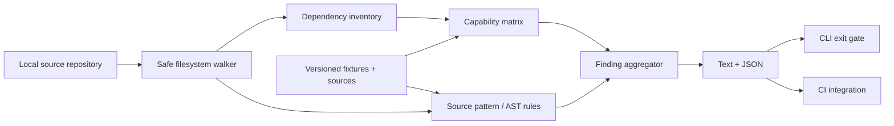

# Build Plan: Protocol 30 Compatibility Scanner

This is the supplied **planning snapshot**, with review corrections below. See [README.md](README.md) for the implemented M0/M1 scope and [docs/evidence.md](docs/evidence.md) for this build's source checks and verification limits. Later milestones and the target tree remain proposals.

**Document version:** 0.1 / 2026-10-25
**Project:** No final brand selected. Working name: `stellar-p30-check`.
**Governance:** The scanner will live in a dedicated GitHub organization, separate from the four other selected Soroban projects. Proposed organization name to be agreed before creation.
**Project type:** Open-source static compatibility analysis tool; no contract deployment required.

## 1. Decision and evidence

**Go decision:** Build Project 9 first, with a sharply bounded MVP. The immediate use case is actionable Protocol 30 migration guidance before the proposed network votes; the product can remain useful as a reusable protocol compatibility checker afterward.

**Supplied planning claim (not independently revalidated in this build):** the cited Stellar upgrade guide lists the Protocol 30 Testnet vote for **November 3, 2026 at 17:00 UTC** and Mainnet vote for **November 23, 2026 at 17:00 UTC**; both are **votes, not guaranteed activation dates**. Protocol 30 adds CAP-84 (`W` muxed contract addresses), CAP-87 (ML-DSA host functions), and CAP-88 (new ledger-header XDR variant arms). Incompatibilities are concentrated in code handling addresses and raw ledger XDR. Older SDKs or homegrown decoders may fail at the first post-upgrade ledger; upgrading the SDK alone may not update application-specific address checks. Existing Soroban contracts generally remain functional without a rewrite. The source blog pages returned proxy HTTP 403 during build review, so the vote dates and guide update date remain unverified here; official CAP/SDK sources were accessible. See `SOURCES.md` and `docs/evidence.md`.

**DripWave adaptation:** We selected the idea, so we enter its Phases 4–7 after a compact live verification of Phases 1–3. Its smart-contract architecture step becomes a static-analysis architecture step. Its coding-agent prompts become Codex tasks and `AGENTS.md`; local deployment becomes binary/CI distribution; hosting is deliberately not included in MVP. Repo hygiene, docs, demo, and approval research remain release gates. Wave eligibility or approval is **not guaranteed**.

## 2. Product statement

> `stellar-p30-check` scans a Stellar application repository for known Protocol 30 compatibility risks, explains each finding with file/line evidence and a precise upgrade path, and optionally generates CI-friendly machine-readable reports. It is a readiness assistant, not a guarantee that a project will work after the network upgrade.

**Initial personas:** Go backend/indexer maintainer; JavaScript/TypeScript wallet or frontend maintainer; Stellar infrastructure integrator maintaining XDR clients.

**Primary outcomes:** Find outdated SDK dependencies, app-level validation rejecting `W` addresses, and raw XDR decoders likely to miss CAP-88 variants. Provide next steps, references, and severity/confidence. Where automated evidence is insufficient, say so.

## 3. Scope fence

### P0 / v0.1 (ship before proposed Testnet vote if gates pass)

- Offline command `p30check scan <path> [--format text|json] [--fail-on none|high]`.
- Deterministic traverser with bounded files, extension selection, `.git`, `node_modules`, `vendor`, `dist`, and generated-file defaults; never execute target code; avoid following symlinks outside root.
- `go.mod`, `go.sum`, `package.json`, and lockfile discovery; dependency normalization with package names from verified official sources.
- Curated compatibility matrix with evidence links and last-checked date: official JS SDK `17.3.0` supports both requirements, JS `16.4.0` supports P30/muxed-contract XDR but **not** the high-level `W` address helpers; official Go SDK `0.8.0` supports Protocol 30. Check exact dependency family and semver; never conflate all JS 16.x releases with 17.x.
- Heuristic source checks: hard-coded address prefix restrictions, address validators that omit `W`, assumptions that muxed addresses can only be `M`, handling `SCAddress` without a muxed-contract variant, and likely raw-XDR ledger-header decoding using pre-P30 libraries. Each rule produces filename, line, rule ID, explanation, evidence type, confidence, and remediation.
- Output human-readable text and versioned JSON schema; stable sorting; exit nonzero only for findings at or above explicitly chosen gate and sufficiently high confidence.
- Fixtures for true positives, true negatives, SDK version/capability edge cases, malformed repo files, and CAP-84/88 schema examples sourced from official material. Zero false 'all safe' claims.
- GitHub CI workflow for this scanner's build/lint/test/race checks; straightforward instructions for calling the compiled scanner as a job in downstream projects.

### P1 (after v0.1)

- SARIF reporting and a published reusable GitHub Action.
- Optional explicit XDR test mode accepting user-supplied base64/XDR fixture inputs against the scanner's **own** decoder, clearly distinguished from the target project's runtime.
- Deeper Go AST and TypeScript AST rules with source-to-sink traces, baselines, ignore annotations, and configurable severity.
- Python/community SDK support only once releases are verified independently.
- Protocol 30 fixtures captured from Testnet after activation, with chain/network/ledger provenance. Do not assume these exist before activation.

### Explicitly out of scope for MVP

- Rebuilding or redeploying existing smart contracts.
- Hosting a dashboard, PostgreSQL, continuous RPC ingestion, network scanning, or an admin console.
- Claiming a codebase is provably safe from all Protocol 30 regressions.
- Automated PRs changing users' repositories, secret collection, or executing code under test.
- Hardcoding undocumented release thresholds for community SDKs.

## 4. Architecture



**One process, no external services.** The CLI reads files and emits reports locally. Separate the rules from I/O: `scan -> discover -> analyze -> normalize -> render -> exit`. The scanner should not call RPC during ordinary scans. Source rule reports **indications**, not proven runtime behavior.

### Proposed repository tree (not created yet)

```text
stellar-p30-check/
├── .codex/config.toml
├── .github/workflows/ci.yml
├── cmd/p30check/main.go
├── internal/cli/{scan.go,scan_test.go}
├── internal/walker/{walker.go,walker_test.go}
├── internal/deps/{go.go,js.go,capabilities.go,capabilities_test.go}
├── internal/rules/{rule.go,address.go,xdr.go,address_test.go,xdr_test.go}
├── internal/report/{model.go,text.go,json.go,report_test.go}
├── testdata/{go-legacy,js-old16,js-modern,address-reject-w,xdr-legacy,clean}
├── docs/{rules.md,limitations.md,ci-integration.md,architecture.md}
├── AGENTS.md
├── README.md
├── CONTRIBUTING.md
├── SECURITY.md
├── LICENSE
├── go.mod
└── go.sum
```

This is a target tree: Codex should evolve it as needed and document justified changes. Use the current supported Go version compatible with the selected official Stellar Go SDK, verified during implementation; do not guess a Go compiler requirement. `go.mod` should pin verified module versions.

## 5. Rules and report contract

Rules below are **proposed rule IDs**, not implemented rules:

| ID | Category | Evidence | Proposed severity | Confidence policy |
|---|---|---|---|---|
| P30-DEP-001 | SDK compatibility | `go.mod`, JS manifests/locks | High when verified incompatible SDK and role affected | High only if concrete package + version resolved |
| P30-ADDR-001 | `W` support | hard-coded accepted prefix/regex/enum plus proven W-capable input domain | High only for rejection where the API/field supports W; medium for suspected omission | High only with supported address context; never flag intentional account-only, AddressObject, or storage-key rejection as high |
| P30-XDR-001 | CAP-88 decoding | pinned old XDR and raw ledger decode use | High when both present; informational when uncertain | Correlate decoder and usage before high |
| P30-TS-001 | timestamp assumptions | assumes strictly increasing whole-second close times | Medium, or info for an isolated clue | Low for isolated patterns |

Findings MUST have: `rule_id`, `severity` (`info|medium|high`), `confidence` (`low|medium|high`), `path`, `line` if known, `message`, `evidence`, `remediation`, `references`. JSON root MUST have: `schema_version`, `tool_version`, `target`, `checked_at_utc`, `findings`, `summary`, `limitations`, `inventory`, `coverage`; partial scan failures also carry `error`. Coverage exposes completeness, rule count, included-file/entry/byte counts, and skipped paths/reasons. Complete means completion within the selected filesystem scope, not compatibility coverage. Check timestamps reproducibility by injecting clock in tests; sorted output. The JSON schema shall be documented and versioned.

**Exit behavior:** 0 for completed scan with no gated findings; 1 for matching high-confidence gated findings (if `--fail-on high`), 2 for scan/configuration errors and unexpected incomplete scans. File/traversal/read-budget exhaustion must produce an incomplete report and exit 2; intentional documented exclusions remain explicit. No finding-driven exit failure by default until consumers opt into gating. Unsupported or unavailable manifest versions generate a warning, **not** a fabricated all-clear.

**Principle:** Classification levels represent evidentiary strength. One static match is not proof of actual breakage. Publish examples of known false positives and false negatives in `docs/limitations.md`.

## 6. Stages and acceptance gates

Targets assume a focused solo/small-team effort. They are **planning targets, not promises**. If validation gates fail, ship a narrower honest tool rather than claiming completeness.

| Milestone | Target window (2026) | Work | Exit gate |
|---|---|---|---|
| M0 — Evidence + design freeze | Oct 25–26 | confirm source URLs, official SDK package/version, Go toolchain; choose rules; fixtures taxonomy; AGENTS | `SOURCES.md` current, no unverified version claims, examples documented |
| M1 — CLI skeleton | Oct 26–27 | `scan`, walker, reporter, deterministic JSON, error codes | builds, unit tests, 2 fixture reports deterministic |
| M2 — Dependency/capability rules | Oct 27–28 | Go/JS package inspection, capability matrix, partial lock parsing | distinguishes JS 16.4.0 (XDR yes/W no), JS 17.3.0 (both), Go 0.8.0 P30 |
| M3 — W address analysis | Oct 28–29 | address-specific patterns and tests | catches rejecting samples without flagging safe samples as high |
| M4 — XDR and timing analysis | Oct 29–30 | CAP-88 code/dependency correlation, low-confidence timing clues | at least 2 representative CAP-88 fixtures; no blanket claims |
| M5 — Verification/CI | Oct 30–Nov 1 | integration tests, race checks, error robustness, CI workflow, fixture attribution | green test suite; clean repo no high-confidence findings |
| M6 — MVP release preparation | Nov 1–2 | docs, quickstart, demo, changelog, threat limitations, candidate tag | repeatable 3-minute demo, documented migration fixes, versioned artifact |
| M7 — Testnet feedback | From Nov 3 vote onward | recheck activation status; run regression/real ledger examples when possible | compare predicted failures with actual fixtures; revise rules |
| M8 — Mainnet hardening | Before Nov 23 vote | SARIF/action candidate, broader source coverage, release checks | documented CI integration and follow-up findings |

**Original planning-snapshot status:** M0 research/planning is underway, but the full verified-source fixture inventory and actual implementation are not complete.

## 7. Acceptance test matrix

- Go dependencies: a verified incompatible **effective selected version**, scoped to the affected module/application, may produce an actionable finding. A go.mod declared minimum or stale go.sum entry alone is insufficient. Handle replace directives/workspaces where statically resolvable; unresolved MVS/graphs, local replacements, and forks remain unknown. Do not execute target commands or fetch dependencies.
- `package.json` / lock: JS `16.4.0` => XDR capability yes, W capability no; `17.3.0` => both yes; JS `16.3.x` => verify capability using live release docs before classification.
- Strong regex validation allowing only `G|M|C` => possible W-rejection review hint only until a W-capable context is proven. Account-only G/M fields, AddressObject inputs, and storage-key validation are required negative fixtures; safe modern parser usage alone must not trigger a high-severity error.
- CAP-88: legacy decoder + `LedgerHeader`/`LedgerCloseMeta` use => risk; modern decoder without restrictive branches => no high-confidence XDR finding.
- Multiple files/path traversal: ignore `node_modules`, `.git`, binary/generated sources; exclude all nonregular files before reading (test a FIFO named input.go); no symlink escape. Unexpected unreadable/invalid input or exceeded limits must produce contextual incomplete errors, not a clean result. Test limit boundaries and exhaustion.
- Scans are deterministic on identical inputs excluding documented timestamp; JSON schema validates; text and JSON finding counts agree.
- `--fail-on high` exits 1 only for high-severity, high-confidence findings. Runtime/internal errors exit 2.
- Testdata includes both positive and negative examples, plus regression fixtures drawn from actual official XDR definitions, never fictional ledger payloads mislabeled as official.

## 8. Security and open-source quality

- Zero secret collection; never evaluate discovered source code; limit input bytes; sanitize all target-controlled text, including paths, evidence, messages, and errors; encode valid JSON and escape terminal controls/newlines in text; no symlink escape.
- Run `go test ./...`, `go test -race ./...`, `go vet ./...`, and build on supported runners. Add static analysis and dependency audit once dependencies are pinned.
- Keep security claims narrow: a scanner finding is guidance, not an audit or safe-deployment certification.
- Repo contributions via PR; conventional commits; focused staging; meaningful tests before each commit; push only to a configured/authorized remote, after user approval of the org/repo and branch.
- Separate docs quick-start, rule catalog, limitations, and contributing policy. Use branch protection with required checks reflecting actual workflow job names only after CI exists.
- Produce a short video showing one clean and one intentionally incompatible repo and the specific fix, not a slideshow.
- Before Drips Wave submission, verify current eligibility, approved-repo list, existing competitors, and application instructions; never assume program approval.

## 9. Decision log / unresolved facts

1. **Name/organization:** working name only; do not create GitHub organization/repo without final choice.
2. **Go version and full dependency set:** M1 uses Go 1.27.3 with a go 1.27.0 module and only the standard library; the reference Stellar SDK v0.8.0 declares Go 1.25.0. See docs/evidence.md. Pin any future module dependency only after verification.
3. **Community SDK thresholds:** deliberately not included until verified.
4. **False positives:** static analysis cannot establish every runtime compatibility issue. Detection quality matters more than raw rule count.
5. **Date risk:** November 3 and 23 are proposed upgrade *votes*; update the schedule if Stellar changes them.
6. **Codex handoff:** package prepared; no Codex task or GitHub remote write was performed here.

## 10. First action for Codex

Read `AGENTS.md`, `CODEX_TASK.md`, `SOURCES.md` and this plan. Implement M0 and M1 only. Do not provision GitHub, generate a frontend, deploy contracts, or claim that the P30 engine is complete. Return a concise evidence table, the actual source tree, tests executed, failing checks, and next commit/issue sequence.
